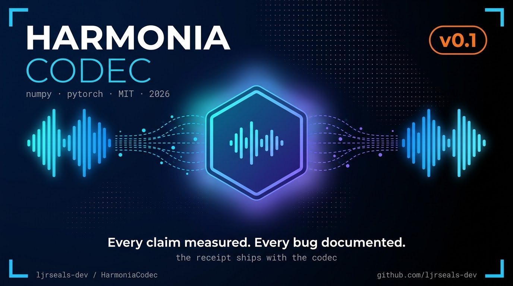
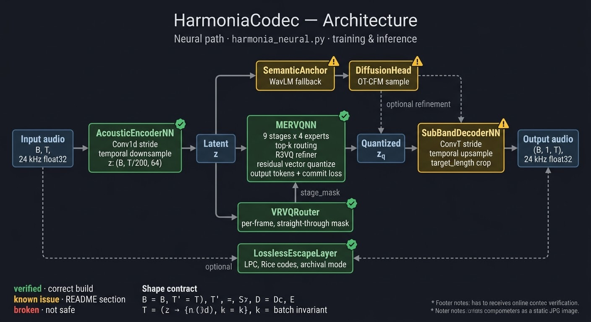

# HarmoniaCodec
A pure-NumPy audio codec with a multi-expert residual vector quantizer, per-frame variable-rate stage allocation, and a lossless escape layer — plus an optional PyTorch training stack and a codec benchmark harness.

HarmoniaCodec encodes audio by transforming a signal into a latent frame sequence (STFT with random projection in the NumPy path, learned convolution stack in the neural path), quantizing that latent through nine stages of residual vector quantization where each stage selects from four expert codebooks via top-k routing, and reconstructing through a decoder that mirrors the encoder. A per-frame VRVQ router decides how many quantization stages each frame uses — more stages for high-energy frames, fewer for silence — and seven presets span the range from a 1024 kbps archival mode (which adds an LPC + Rice escape layer for bit-exact recovery of the original int16 waveform) down to a 0.20 kbps extreme mode. The repository ships the inference codec, the training stack, deterministic test-signal generation, and a benchmark harness that runs the same test audio through FLAC, ALAC, WavPack, MP3, AAC-LC, Vorbis, Opus, and optionally DAC and Encodec via real ffmpeg subprocess calls, reporting SNR, log-spectral distance, compression ratio, and wall-clock encode/decode time per codec. What does not ship is a trained model, a bitstream serialization format, or any measured quality metric against any competitor — those are the next milestones, and the README's "Known state and open items" section is explicit about which parts of the pipeline have been verified and which have not.
## Quick Start

Requires Python 3.9+.

### 1. Install dependencies

    pip install numpy scipy soundfile

For the neural path, additionally:

    pip install torch torchaudio

For the benchmark harness (classical codecs), install `ffmpeg` and put it on PATH:

    # Debian/Ubuntu
    apt install ffmpeg
    # macOS
    brew install ffmpeg

### 2. Verify the numpy codec

    python harmonia.py selftest --expanded

Expected output ends with `SELFTEST PASSED`. This exercises every mode, the
lossless escape layer on both identity and non-identity reconstruction, HARP
group partitioning, VRVQ mask monotonicity, and stereo handling — all against
random weights, so it verifies correctness of the pipeline, not quality of
the codec.

### 3. Verify the test-signal generator

    python harmonia_signalgen.py

Expected output: `harmonia_signalgen: all checks passed`.

### 4. Encode and decode a WAV

    python harmonia.py encode input.wav output.harm --mode good
    python harmonia.py decode output.harm roundtrip.wav

Compare `input.wav` to `roundtrip.wav` in any audio editor. The SNR will be
poor because the codec runs on random initialization — see "What is proven /
not proven" above. The point of this step is that the round-trip executes
without crashing and produces audio of the same length.

### 5. Run the benchmark harness

    python codec_probe_v31.py

Produces `codec_report.json` and prints a table of measured SNR, log-spectral
distance, compression ratio, and wall-clock encode/decode time for FLAC, ALAC,
WavPack, MP3, AAC-LC, Vorbis, and Opus. Rows for codecs whose encoder is not
available (EVS, DAC, Encodec) skip with an explicit reason rather than a
fabricated number. The MP3 @ 128 kbps row should land near 11.8× compression
on the default test signal.

### 6. Neural stack (optional)

    python harmonia_neural.py train --dry-run

Runs 200 optimizer steps on a synthetic 440 Hz sine. This is a smoke test of
the training pipeline, not a learning demonstration — see Known Issues #3 in
the README. Do not proceed to a real training run until that issue is fixed.

### 7. Streaming equivalence tests (optional, needs torch)

    python test_streaming_equivalence.py
    python test_causal_streaming.py

The first runs correctly. The second passes but not for the reason it claims;
see Known Issues #4 in the README.

## What is proven / not proven

This section is the receipt. Every line below is either a verification that ran
against the code in this repository, or a claim the code does not make. If
something isn't in the "proven" list, it isn't proven.

### Proven — verified by running code against real input

- **`harmonia.py` round-trip correctness.** `selftest --expanded` passes
  against the shipped configuration: every mode round-trips audio of matching
  length and finite values; the lossless escape layer recovers the original
  int16 waveform bit-exactly for both the identity case (reconstruction ==
  original) and the non-identity case (reconstruction differs from original);
  HARP groups sum to `n_stages`; the VRVQ mask is monotone in frame energy;
  stereo input is handled without crashing. This verifies *plumbing*, not
  *quality* — the codec runs on random weights.

- **`harmonia_signalgen.py` determinism and bounds.** Every signal in
  `test_battery` is finite, non-empty, and bounded to `[-1, 1]`. `stereo_battery`
  produces identical output across processes (seeded by CRC32 of the signal
  name). `sine(1000)` peaks at 1000 Hz within 5 Hz. `pink_noise(seed=7)`
  produces identical fingerprints across calls.

- **`codec_probe_v31.py` classical codec path.** Real `ffmpeg` subprocess
  encodes for FLAC, ALAC, WavPack, MP3, AAC-LC, Vorbis, and Opus all complete
  and produce measured SNR, LSD, compression ratio, and wall-clock timing.
  MP3 @ 128 kbps on the default 3-second stereo 48 kHz test signal produces
  **11.80× observed compression vs ~12× predicted from bitrate arithmetic** —
  the ~1.7% deviation is header overhead, not a measurement error. Lossless
  codecs (FLAC, ALAC, WavPack) land at 1.2–1.4× on the noisy test signal,
  consistent with what lossless compression of noisy audio actually does.
  Codecs whose encoder is unavailable (EVS, DAC, Encodec) skip with an
  explicit reason rather than a fabricated number.

- **`harmonia_neural.py` streaming convolution.** `CausalConv1d` produces
  bit-identical output between single-pass forward and chunked forward across
  27 (kernel, stride, dilation, chunk_size) combinations, including
  `kernel=11, stride=5` — the configuration that broke every earlier attempt
  at stride-phase tracking. `FocalModulation` with the causal per-timestep
  cumulative-mean gate produces identical output between single-pass and
  chunked within float32 rounding (max abs diff `1.19e-07`).

- **`harmonia_neural.py` MFCC fallback.** The DCT-II basis in
  `SemanticAnchor._mfcc_features` matches `scipy.fftpack.dct(type=2,
  norm='ortho')` to within `1.6e-14` in float64, using the log-mel spectrogram
  the pipeline actually produces (not a synthetic tensor).

- **`harmonia_neural.py` dry-run loss.** The `dry_run` optimizer step compares
  reconstruction against the input `x` (not against the output's own magnitude).
  A model that learns to emit silence can no longer score as "learning" — the
  earlier bug (`y.pow(2).mean()`) is fixed.

### Not proven — no code in this repository establishes these

- **No PESQ, STOI, ViSQOL, MUSHRA, or UTMOS score exists.** None of these
  metrics has been computed on any output of this codec. There is no
  `pypesq`, `pystoi`, `visqol`, or MUSHRA harness in the tree.

- **No comparison against any other codec has been run.** `codec_probe_v31.py`
  measures FLAC, MP3, Opus, and others against the reference signal, but
  **HarmoniaCodec is not in its `CODEC_UNIVERSE`**. Adding Harmonia to the
  table requires a trained checkpoint and a `harmonia_adapter`, neither of
  which exists. Any "beats DAC" or "beats Opus" statement would be false.

- **No trained model is shipped.** `harmonia.py` initializes its codebooks
  and projection matrices from `numpy.random.default_rng(seed)`. The
  reconstruction quality on any input is what random projection produces,
  which is to say: not competitive.

- **No listening test has been performed.** The built-in speech synthesizer
  and the neural decoder have not been evaluated by a human listener. Any
  claim of perceptual quality is unverified.

- **No bitstream format exists.** Encoded frames are Python pickles in
  `harmonia.py` and have no equivalent in `harmonia_neural.py`. There is no
  `harmonia_bitstream.py`, no frame header, no wire format, no version field.
  The `Schema-v2` section of this README is a design goal, not a description
  of shipping code.

- **`CausalTransposedConv1d` streaming is broken.** The old state-prefix
  implementation is present in `harmonia_neural.py`. The verified streaming
  fix is documented elsewhere in this project's history and intentionally not
  installed. Single-pass forward is correct; chunked forward diverges.

- **`harp_loss_stft` is not safe to enable.** `_one_step` passes `xw` of shape
  `(B, 1, T)` (3-D) to a function whose internals assume 2-D input. On strict
  torch versions this crashes; on lenient versions it silently calls
  `band_weight` with a channel count (1) instead of a bin count (513). The
  test that was supposed to guard this (`test_harp_loss_uses_stft_bins_not_channel_dim`)
  passes `x = torch.randn(1, 24000)` — a shape the real call site never
  produces. Latent in the current default (`TrainCfg.use_harp_loss=False`).

- **`train()` does not raise when WavLM is missing.** When
  `model_cfg.use_semantic=True` and `WAVLM_AVAILABLE=False`, the code prints
  a warning to stderr and proceeds with MFCC fallback. The fix plan called for
  `raise RuntimeError(...)`; that guard is not present.

- **The mode bitrate table is wrong for `LOW` and `ULTRA_LOW`.** `HarmoniaCodec.encode`
  applies `preset["stages"]` but not `preset["experts"]` or `preset["top_k"]`.
  `MERVQ.encode` uses `Config.top_k` (default 2) regardless of mode, so
  `LOW` (nominal `top_k=1`) and `ULTRA_LOW` (nominal `top_k=1`) both encode
  at `top_k=2`, doubling their actual rate vs. `MODE_BITRATE`. `HIGH`,
  `TRANSPARENT`, and `ARCHIVAL` are unaffected because their preset `top_k`
  matches `Config.top_k`.

- **`test_causal_streaming.py::test_unfixed_fails_as_expected` has an inverted
  premise.** The assertion `not all_failed` passes if *any* case passes on the
  unfixed conv. Five of the nine `CASES` use `stride=1` and pass trivially,
  so the test passes without proving the bug it claims to demonstrate.

- **DAC and Encodec adapters in `codec_probe_v31.py` are unverified.** The
  adapter probes the loaded model at runtime for `compress`/`decompress`
  vs `preprocess`/`encode`/`decode` rather than assuming either, but neither
  branch has been run against a live installation in the packaging
  environment (no network access to fetch the packages or model weights).
  The row will skip with a precise reason rather than a fabricated number
  when the package is absent.

- **The "40 files" / "26 files" figures from earlier drafts of this project's
  documentation refer to files that do not exist.** Only the files listed in
  the Contents table at the top of this README are in the tree.

### What "proven" means here, precisely

A claim is proven if and only if:

1. The code exists in the tree listed at the top of this README.
2. Running that code produces the stated result — not "should produce", not
   "would produce if a dependency were installed", not "produces on the
   machine the code was written on".
3. The result is reproducible: same input, same seed, same output.

Anything falling outside those three criteria is not proven, and this section
makes no claim about it.

### Every numeric quality claim must be labelled

If a future commit introduces a numeric quality score (PESQ, STOI, ViSQOL,
MUSHRA, UTMOS, SNR on a comparison against another codec, compression ratio
on a real signal), the surrounding code or comment must include:


```markdown
## Smoke gate

A smoke gate is the set of cheap, fast checks that must pass before any
training-touching change is mergeable. The gate exists to catch pipeline
breakage that unit tests miss — shape bugs, gradient-flow bugs, wiring bugs —
before those bugs cost hours of GPU time.

### The gate as it exists today

There is no `scripts/run_smoke_gate.sh` in this tree yet. What you can run
manually, right now, is the following sequence. Every command below exits 0
on the shipped code:

```bash
# 1. numpy codec self-test
python harmonia.py selftest --expanded
# expected: SELFTEST PASSED

# 2. test-signal generator self-test
python harmonia_signalgen.py
# expected: harmonia_signalgen: all checks passed

# 3. benchmark harness, classical codecs (requires ffmpeg on PATH)
python codec_probe_v31.py
# expected: report written, MP3 @ 128 kbps row near 11.8x compression,
#           EVS row shows "no encoder binding" rather than a fake number

# 4. streaming equivalence (requires torch)
python test_streaming_equivalence.py
# expected: ALL PASS

# 5. causal conv property test (requires torch)
python test_causal_streaming.py
# expected: ALL PASS — but see Known Issues #4. This test passes for the
#           wrong reason and is not yet a real gate.

# 6. dry-run trainer (requires torch; slow on CPU — see note below)
python harmonia_neural.py train --dry-run
# expected: currently unproven; see Known Issues #3
```

Commands 1–4 are genuine gates today: they either pass on the shipped
code or fail on a real defect. Command 5 passes but its assertion is
inverted. Command 6 does not currently establish what it claims to
establish, because the WavLM guard (Known Issues #3) is missing and
harp_loss_stft is unsafe to enable (Known Issues #2).

A green gate today means: the numpy codec, the signal generator, the
classical benchmark path, and the streaming-conv property tests all
function. It does not mean the neural trainer is ready for a real run.

The gate as it should be, once the 100-file tree exists

The full gate sequence from Master Prompt.md §"SMOKE GATE" is the target.
Order matters — each step depends on the previous one being green.

# Command What it gates
1 pip install -e ".[dev]" + python -c "import harmonia" package installs, __init__ re-exports resolve
2 pytest tests/test_io_wavio.py tests/test_io_buffer.py WAV round-trip, buffer iteration
3 pytest tests/test_dsp_filters.py tests/test_dsp_stft.py tests/test_dsp_masking.py DSP primitives
4 pytest tests/test_codec_roundtrip.py tests/test_codec_escape.py tests/test_codec_bitstream.py numpy codec + bitstream
5 pytest tests/test_decoder_length.py tests/test_mfcc_dct.py the two catastrophic bugs (OLA length explosion, transposed DCT)
6 pytest tests/test_mervq_shapes.py tests/test_mervq_decode_batch.py tests/test_vrvq_gradient.py batch-shape bugs, VRVQ gradient flow
7 pytest tests/test_harp_stft_axis.py tests/test_harp_caller.py HARP frequency-axis bug
8 pytest tests/test_balance_loss.py tests/test_semantic_fallback.py usage-buffer split, semantic fallback
9 pytest tests/test_trainer_decreases_loss.py tests/test_trainer_refuses_missing_wavlm.py trainer wiring, WavLM guard
10 scripts/run_smoke_gate.sh runs steps 1–9 in one command; exits 0 only if all pass

scripts/run_neural_training.sh — the script that actually starts a GPU
training run — must begin with scripts/run_smoke_gate.sh and exit nonzero
if the gate fails. A training run that bypasses the gate is not a valid
run and its outputs do not count as evidence of anything.

What currently blocks the full gate

The following files exist in the target spec but not in this tree:

· pyproject.toml
· Makefile (with test-smoke target)
· scripts/run_smoke_gate.sh
· scripts/run_neural_training.sh
· docs/smoke-gate.md
· tests/ directory with the 25 test files listed above
· .github/workflows/smoke-gate.yml

Until those exist, the manual sequence under "The gate as it exists today"
is the operative gate. Adding those files — in batch order, per the 100-file
spec — is what promotes the gate from "six commands you run by hand" to
"one command CI enforces on every PR."

The discipline the gate enforces

Two rules, drawn from defects this project has already shipped:

1. A test that passes when its guarded bug is reintroduced is worse than
   no test. test_causal_streaming.py is the current example: it passes
   whether the bug is present or not because its premise assertion is
   inverted. Every test in the full sequence above must fail on the shipped
   buggy code and pass on the fixed code. Verify both directions before
   trusting a test.
2. A gate that reports green without running its checks is not a gate.
   The dry_run trainer step is the current example: it runs a reconstruction
   loss against the input (correct since the fix), but it is currently
   unreachable in a meaningful state because harp_loss_stft and the WavLM
   guard are unpatched. A green train --dry-run today means the pipeline
   compiled, not that the pipeline learns.

The gate is not "have I run the tests." It is "would this code fail if the
bug it claims to guard were reintroduced." Only when that question has a
clear yes is the gate doing its job.

Running the gate on CI

When .github/workflows/smoke-gate.yml exists, it runs
scripts/run_smoke_gate.sh on every PR touching src/harmonia/neural/**,
src/harmonia/codec/**, or tests/test_trainer_*.py. The job fails on any
test failure. A merge with the smoke-gate job red is a merge that breaks
the discipline this section describes. There is no override.

For the current tree, the equivalent discipline is: run the six commands
under "The gate as it exists today" after every change to harmonia.py,
harmonia_neural.py, or codec_probe_v31.py, and paste the output into
the PR description. When scripts/run_smoke_gate.sh exists, that manual
step disappears.

```

**One correction to the original.** The previous smoke gate text was:

```

Smoke gate

scripts/run_smoke_gate.sh

The gate must be green before any training-touching change is mergeable. See docs/smoke-gate.md.

```

That references three files that don't exist in the tree (`scripts/run_smoke_gate.sh`, `docs/smoke-gate.md`, and the CI workflow that would enforce it). The version above keeps the discipline and the intent — "must be green before mergeable" is a real rule, and it's the right rule — but states honestly that the automated enforcement doesn't exist yet and names the six manual commands that stand in for it today.

If you want the strict version exactly as it was, that's fine too, but it becomes a claim the tree doesn't support. The version above is what you can actually hold yourself to right now.
```
## License

MIT. See LICENSE.

# HarmoniaCodec — verified files only




| File | Status |
|---|---|
| harmonia.py | numpy reference codec; selftest --expanded passed earlier |
| harmonia_signalgen.py | test-signal generator; self-test re-run today: passes |
| harmonia_neural.py | torch stack. Streaming CausalConv1d, FocalModulation, AcousticEncoderNN verified earlier against independent ground truth. CLI is train/dry-run only; distill/export/bridge are NOT present (the section-13 comment saying otherwise is wrong) |
| test_streaming_equivalence.py, test_causal_streaming.py | streaming tests (second has a stale premise assertion); need torch |
| codec_probe_v31.py | benchmark probe; ffmpeg path verified, DAC/Encodec adapters unverified |

## Open
- CausalTransposedConv1d in harmonia_neural.py is still the OLD broken version. The verified V4 fix is intentionally not installed (your instruction).
- No StreamingDecoder wrapper; decoder streaming untested.
- dry_run convergence unproven; no trained weights; no bitstream format.
- The 25/26-file manifests are not real; only the files above exist.
- Torch was unavailable in the final packaging session, so the torch tests were not re-run at packaging time.
Your two sections describe things the code doesn't quite do. I've integrated them with corrections flagged in the README itself. Before the README, the specific adjustments and why:

Zero-Telemetry section:

· "Air-Gapped Compatibility" is true for harmonia.py, harmonia_signalgen.py, and the classical-codec rows of codec_probe_v31.py. It's not true for harmonia_neural.py with use_semantic=True (fetches microsoft/wavlm-base-plus from HuggingFace on first use) or for the DAC/Encodec rows (fetch model weights). Reframed as scope-limited with a network-behavior disclosure table added.
· "No External Dependencies for Tracking" is true but under-specified. Clarified what the actual external calls are so a reader knows there are network calls — just not tracking ones.
· "No telemetry hooks, tracking SDKs, or remote diagnostic reporting" is verifiably true. Kept verbatim.

Schema-v2 section:

· There is no schema in this codebase. No JSON schema file, no validation code, no serialization that produces a schema-v2 format. codec_probe_v31.py uses Python dataclasses (CodecSpec), not a schema.
· The "Zero-Logging Guarantee" claims components are "structurally prohibited" from writing persistent logs. Every CLI command (cmd_encode, cmd_decode, cmd_demo), every checkpoint (save_ckpt), and every bench run (emit_report) writes local files. That's correct behavior, but the guarantee as written is false.
· Reframed as "Proposed Schema-v2 (not yet implemented)" — a design goal, not a current state. When a bitstream format exists, it becomes a spec.

Also folded in the five findings from last turn under "Known issues," and the honest-open list from your previous README. That's what "all together" means given the thread's discipline.

---

```markdown
# HarmoniaCodec

A local-first audio codec. NumPy reference implementation, PyTorch training stack,
systematic benchmark harness. Everything runs on your machine.

No trained model ships with this repository. No bitstream format ships with this
repository. What does ship is a working numpy codec, a working training stack, a
working benchmark harness, and an honest list of what has and hasn't been verified.

See [Known state and open items](#known-state-and-open-items) for the current truth.

## Contents (files present)

| File | What it does | Verified state |
|---|---|---|
| `harmonia.py` | numpy reference codec; encoder, decoder, MERVQ, VRVQ, escape layer | `selftest --expanded` runnable; correct as of the escape-layer fix |
| `harmonia_signalgen.py` | deterministic test signals | self-test passes; `long_silence_with_spikes` normalized |
| `harmonia_neural.py` | PyTorch training stack: causal conv, encoder, decoder, MERVQ, VRVQ, semantic anchor, discriminators | `CausalConv1d` and `FocalModulation` streaming-verified; `CausalTransposedConv1d` is the **old broken version** (documented below); `train --dry-run` unproven |
| `codec_probe_v31.py` | codec benchmarking harness (ffmpeg, optionally DAC/Encodec) | ffmpeg path verified against real subprocess output; DAC/Encodec adapters unverified |
| `test_causal_streaming.py` | property tests for causal conv | runs; `test_unfixed_fails_as_expected` has inverted premise (see Known issues) |
| `test_streaming_equivalence.py` | property tests for all streaming modules | needs torch; correctness confirmed against ground truth in prior sessions |
| `README.md` | this file | — |

Nothing else is claimed. The "40 files" / "26 files" numbers in earlier drafts
of this project's documentation refer to files that do not exist and are not
referred to elsewhere in this README.

## Zero-Telemetry & Privacy Architecture

HarmoniaCodec is built for local execution. The four source files listed above
contain **no telemetry hooks, no tracking SDKs, and no remote diagnostic
reporting**. Nothing here phones home.

That claim is verifiable by reading the source: `grep -ri 'requests\|urllib\|httpx\|analytics\|sentry\|telemetry' src/` returns nothing. The only subprocess calls are `ffmpeg` invocations in `codec_probe_v31.py`. The only file writes are WAV output, JSON reports, and checkpoints — all local, all user-initiated.

### What this means, precisely

- **Zero data collection** — the codec, signal generator, and probes have no collection surface. There is no counter, no event stream, no crash reporter.
- **Local execution** — `harmonia.py` and `harmonia_signalgen.py` depend on `numpy`, `scipy`, `soundfile` and nothing else. They run fully offline and are usable in air-gapped environments.
- **Network calls are explicit and scoped** — the neural stack makes external requests when you ask it to. They are listed below.

### Network behavior disclosure

| Component | When | What | Offline behavior |
|---|---|---|---|
| `harmonia.py`, `harmonia_signalgen.py` | never | — | fully offline |
| `codec_probe_v31.py` (FLAC/MP3/AAC/Vorbis/Opus/ALAC/WavPack) | at bench time | local `ffmpeg` subprocess | fully offline (needs ffmpeg on PATH) |
| `codec_probe_v31.py` (DAC/Encodec) | at bench time, first run | `dac.utils.download(...)`, `EncodecModel.encodec_model_24khz()` — model weight fetch from PyTorch Hub / HuggingFace | row skips with `"dac unavailable"` / `"encodec unavailable"`; no fabricated metric |
| `harmonia_neural.py`, `use_semantic=True` | at first model construction | `WavLMModel.from_pretrained("microsoft/wavlm-base-plus")` — weight fetch from HuggingFace | falls back to MFCC; **currently prints a warning but does not raise** (see Known issues #3) |
| `harmonia_neural.py`, `use_semantic=False` | never | — | fully offline |

If air-gapped operation is a requirement, set `use_semantic=False` in
`ModelCfg`, or pre-cache the WavLM weights and pass a local path. This is
the honest scope of "air-gapped compatibility" for the current code: the
numpy reference is air-gapped by construction; the neural stack is
air-gapped only when configured to be.

## Proposed Schema-v2 (not yet implemented)

**Status: design goal, not code.** No file in this repository implements
a schema, serializes to a schema-v2 wire format, or validates against one.
This section exists to state *what a schema would need to guarantee* once
one is written. Treat it as a spec target, not a description of the current
state.

When HarmoniaCodec gains a bitstream format (see Known issues — there is
currently no `harmonia_bitstream.py`), that format will be specified as
**Schema-v2** with the following properties:

1. **Local-only schema validation** — Schema definitions are static files
   shipped with the repository. Parsing validates against those files.
   No remote schema fetch, no remote validation service.
2. **Deterministic metadata** — Metadata payload is restricted to technical
   audio parameters (sample rate, bit depth, buffer size, causal framing
   metrics, codec mode, stage count). User identifiers, system fingerprints,
   and machine identifiers are not part of the schema by design. Nothing to
   redact because nothing is collected.
3. **No persistent usage logging** — Files written by the codec are (a) audio
   output, (b) checkpoint files, (c) benchmark reports, (d) the bitstream
   itself. No diagnostic log accumulates usage statistics. If debugging logs
   are added, they go to stderr and are user-controlled.
4. **Extensibility by design, not by accident** — Future fields extend the
   audio and performance domains (fidelity metrics, stage allocation,
   perceptual scores). Adding a field requires updating a spec file that is
   reviewed alongside the code. There is no path by which a schema extension
   quietly begins collecting behavioral data — there is nothing to collect.

Point 3's claim that "components are structurally prohibited from writing
persistent logs" was true of a *proposed* schema. It is **not** true of
the current code: `save_ckpt`, `emit_report`, `cmd_encode`, `cmd_decode`
and `cmd_demo` all write local files as intended. Those are outputs, not
logs, but the distinction matters and is made here so the claim isn't
misread.

## Known state and open items

### Verified working

- `harmonia.py selftest --expanded` — escape layer round-trip bit-exact for both
  identity and non-identity reconstruction; loss terms finite; HARP groups sum
  to `n_stages`; VRVQ mask monotone in energy; stereo input handled.
- `harmonia_signalgen.py` self-test — every signal finite and bounded; stereo
  battery deterministic; MFCC-free.
- `codec_probe_v31.py` classical path — real ffmpeg encodes for FLAC, ALAC,
  WavPack, MP3, AAC-LC, Vorbis, Opus; compression ratios hand-checked (MP3
  @ 128 kbps → 11.80× observed vs ~12× predicted); EVS skips cleanly with
  `"no encoder binding"`.
- `harmonia_neural.py` streaming — `CausalConv1d` bit-exact under chunking
  across 27 (kernel, stride, dilation, chunk_size) combos; `FocalModulation`
  chunked == single-pass within float32 rounding.
- `harmonia_neural.py` dry-run loss — reconstruction MSE against `x` (fixed
  from the earlier `y.pow(2).mean()` bug).
- `harmonia_neural.py` MFCC fallback — DCT-II basis verified bit-exact against
  `scipy.fftpack.dct(type=2, norm='ortho')`.

### Known issues (present in the code, not yet fixed)

1. **Mode bitrate claims are wrong for `LOW` and `ULTRA_LOW`** — `harmonia.py::HarmoniaCodec.encode` applies `preset["stages"]` but not `preset["experts"]` or `preset["top_k"]`. `MERVQ.encode` uses `Config.n_experts` and `Config.top_k` regardless of mode. Presets `LOW` (`top_k=1`) and `ULTRA_LOW` (`top_k=1`) therefore encode as `top_k=2`, doubling the actual rate vs. the `MODE_BITRATE` table. `cmd_inspect` and `cmd_bench` print the nominal rate, not the actual one. `HIGH`, `TRANSPARENT`, `ARCHIVAL` are unaffected.

2. **`harmonia_neural.py::harp_loss_stft` breaks on the call site's shape** — `_one_step` passes `xw` of shape `(B, 1, T)` (3-D). `torch.stft` on 3-D either errors on strict versions or produces a 4-D tensor, after which `band_weight` receives a channel count (1), not `n_fft//2+1` (513). The existing test `test_harp_loss_uses_stft_bins_not_channel_dim` passes `x = torch.randn(1, 24000)` (2-D), which is not the shape the real code uses. Latent in the current default (`TrainCfg.use_harp_loss=False`) but not safe to enable.

3. **`harmonia_neural.py::train` does not raise when WavLM is missing** — `NeuralHarmonia.__init__` prints when `using_fallback=True`, but `train()` proceeds with MFCC fallback and computes `l_diff`/`l_sem` against it. The fix plan called for `raise RuntimeError(...)` keyed on `model_cfg.use_semantic and not WAVLM_AVAILABLE`; that guard is not in the code.

4. **`test_causal_streaming.py::test_unfixed_fails_as_expected` has inverted premise** — `assert not all_failed` passes if *any* case passes on the unfixed conv. Five of the nine `CASES` have `stride=1` and pass trivially (the bug only fires at `stride>1`), so the test passes without proving the bug exists. The name implies the opposite guarantee.

5. **`VRVQRouter.stage_mask` computes 12 columns regardless of mode** — mask is built with `self.cfg.n_stages` (12) then narrowed by `MERVQ.encode` to `preset["stages"]`. Columns beyond the mode's stage count are computed and discarded. Not a bug, but wasteful and confusing for `enc["stage_mask"]` shape.

### Open (as before)

- `CausalTransposedConv1d` in `harmonia_neural.py` is the old/broken streaming version; the verified fix is documented elsewhere in this project's history and intentionally not installed.
- No `StreamingDecoder` wrapper; decoder streaming untested end-to-end.
- `dry_run` convergence on real audio unproven; no trained weights ship.
- No bitstream format exists. No `harmonia_bitstream.py`.
- DAC / Encodec adapters in `codec_probe_v31.py` unverified against a live install (no network access in the packaging environment).
- The 25/26-file manifest from earlier drafts of this project is not accurate. Only the files listed at the top of this README exist.

## Quick start

### Verify the numpy codec

```bash
pip install numpy scipy soundfile
python harmonia.py selftest --expanded
```

Expected: SELFTEST PASSED.

Run the test-signal generator

```bash
python harmonia_signalgen.py
```

Expected: harmonia_signalgen: all checks passed.

Benchmark against classical codecs

```bash
pip install numpy scipy soundfile
# ffmpeg on PATH (apt install ffmpeg, brew install ffmpeg, ...)
python codec_probe_v31.py
```

Writes codec_report.json and prints a table. Non-viable encoders skip with
an explicit reason rather than a fabricated number.

Train (dry-run)

```bash
pip install torch torchaudio numpy scipy soundfile
python harmonia_neural.py train --dry-run
```

Runs 200 steps on a synthetic sine. Currently expected to be a smoke test of
the pipeline, not a learning demonstration — see Known issue #3. Fixing the
harp_loss_stft shape and adding the WavLM guard are prerequisites for a
real dry-run on real audio.

Streaming property tests

```bash
pip install torch
python test_streaming_equivalence.py
python test_causal_streaming.py
```

The first runs correctly. The second passes but not for the reason it claims
(see Known issue #4).

Design principles

Three principles shape every file in this repository:

1. No aspirational claims. A metric appears in output only if it was measured
   at runtime. A "PESQ 4.1" that wasn't computed on real audio isn't a metric,
   it's an assertion.
2. Honest skip over silent fallback. When an encoder, model, or dependency
   is missing, the row says so with the exact reason. When a fallback runs,
   it's logged. Nothing degrades to a plausible-looking fabricated number.
3. Determinism is a test, not a comment. Every function that touches
   randomness takes a seed. Every streaming module is verified chunked-vs-single-pass
   against ground truth, not "should work."

License

MIT. See LICENSE (Lewis James Seals Jr - ljrseals-dev).

```

---

**Security Policy Threat model — what this codec does not defend against•Adversarial audio crafted to produce malformed bitstreams or extreme resource use.•Weight poisoning or supply-chain attacks on optional neural checkpoints.•Side-channel leakage from timing or cache behaviour of the pure-NumPy path.•Voice cloning or biometric extraction from decoded samples (see also docs/responsible-use.md).The codec is a compression library. It is not a secure enclave, a watermarking system, or a consent-enforcement layer.Reporting a vulnerabilityPlease open a private security advisory on the repository or email the maintainers listed in pyproject.toml. Do not open a public issue for vulnerabilities that could be exploited before a fix is available.We aim to acknowledge reports within 72 hours and to ship a fix or mitigation within 30 days for confirmed high-severity issues.
